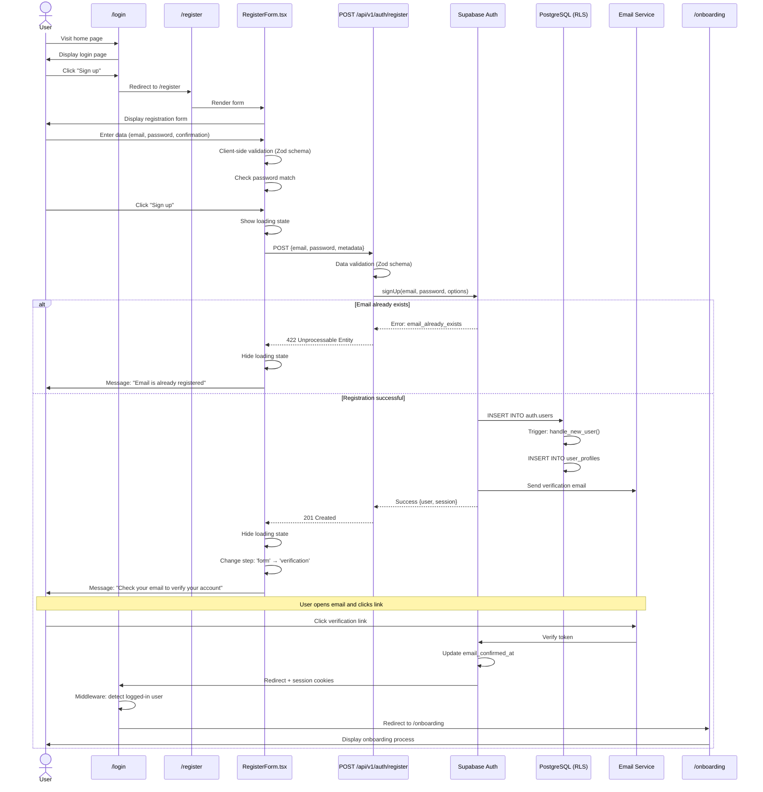
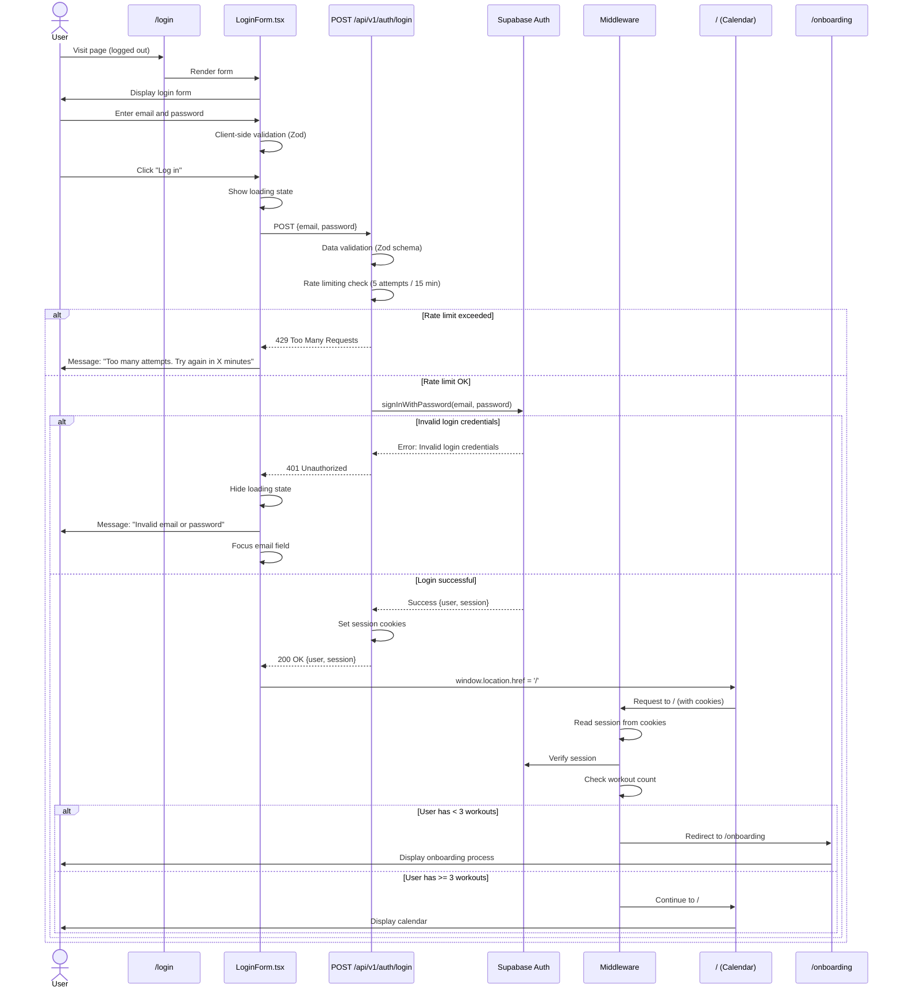
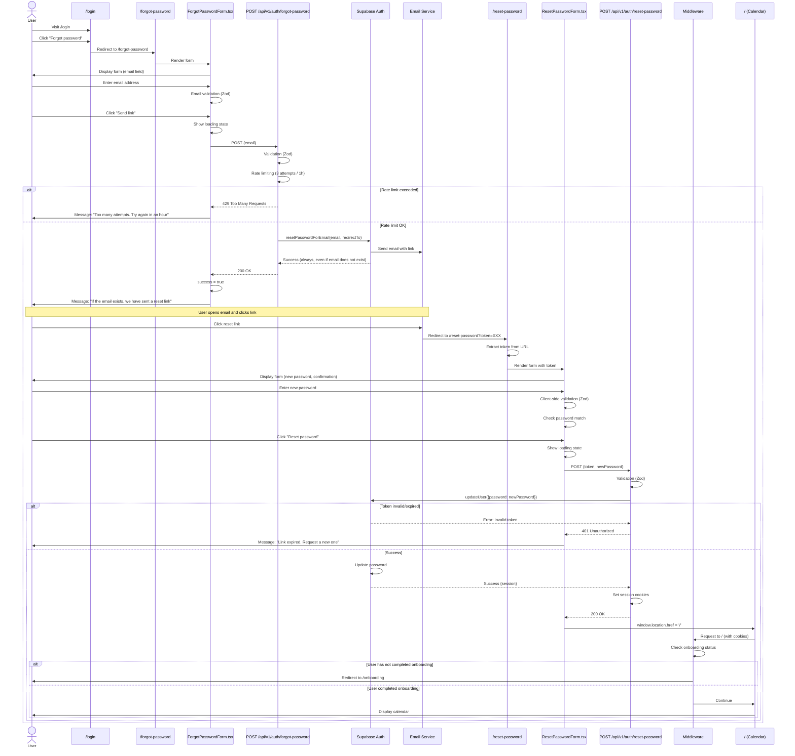
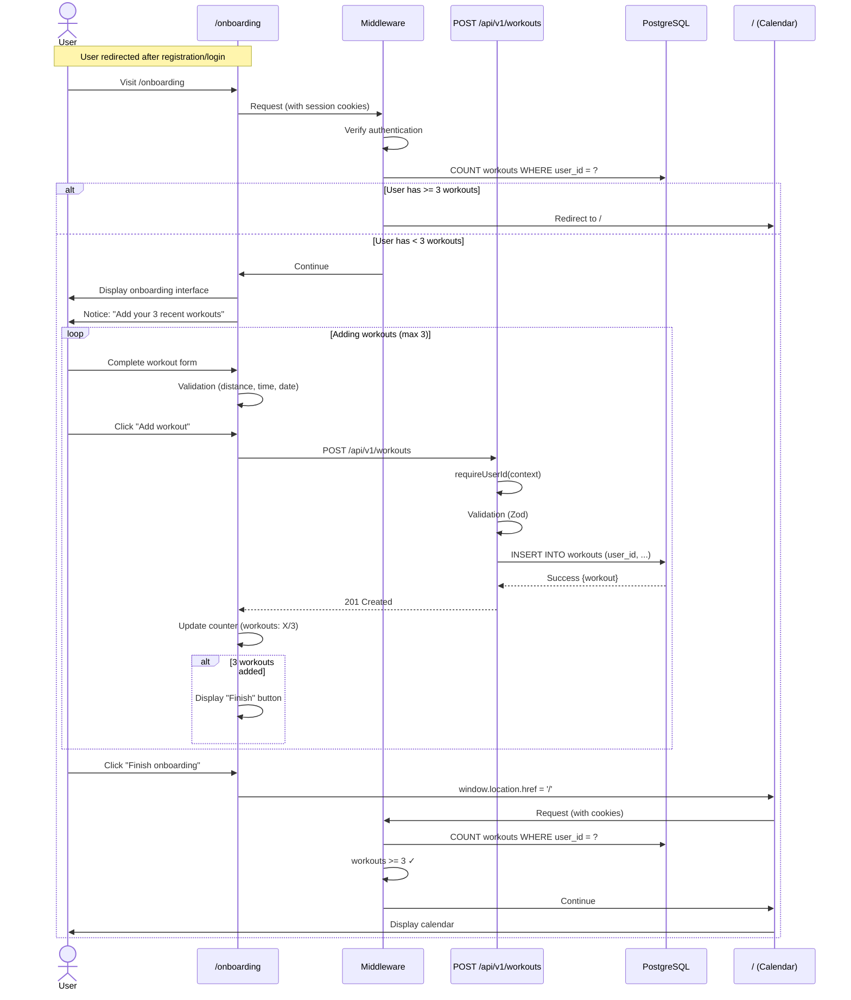
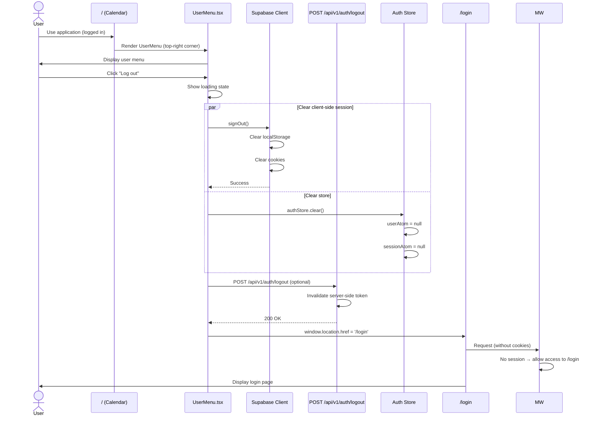
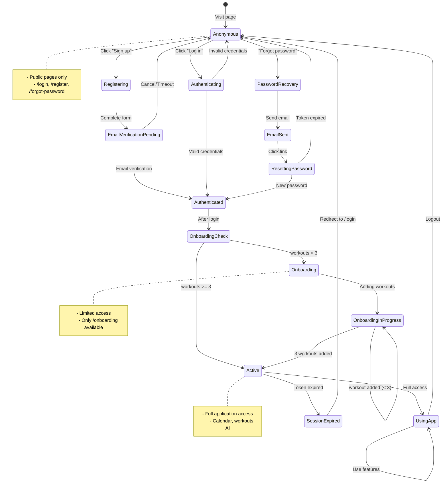
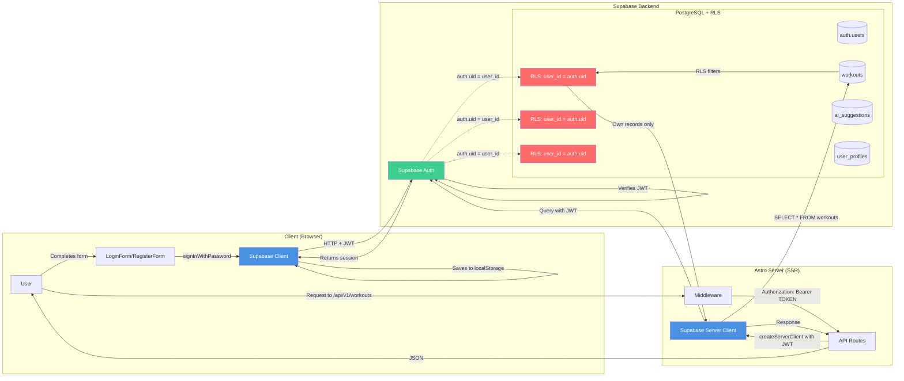
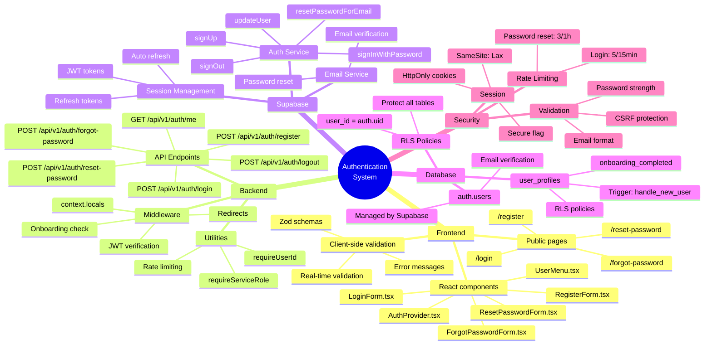

# Authentication Journey - Mermaid Diagrams

## 1. Main User Journey


## 2. Registration Flow



## 3. Login Flow



## 4. Password Recovery Flow



## 5. Onboarding Flow



## 6. Logout Flow



## 7. User State Diagram



## 8. Middleware and Route Protection Architecture

```mermaid
flowchart TD
    Start([Request]) --> MW[Middleware]
    MW --> CheckPath{Check path}

    CheckPath -->|/api/v1/auth/*| AllowAPI[Allow auth API]
    CheckPath -->|/login, /register, etc.| CheckPublic{Logged in?}
    CheckPath -->|Other paths| CheckAuth{Logged in?}

    CheckPublic -->|Yes| RedirectHome[Redirect to /]
    CheckPublic -->|No| AllowPublic[Render public page]

    CheckAuth -->|No| RedirectLogin[Redirect to /login?redirectTo=...]
    CheckAuth -->|Yes| CheckOnboarding{Check onboarding}

    CheckOnboarding -->|Path = /onboarding| AllowOnboarding[Render /onboarding]
    CheckOnboarding -->|Other path| CountWorkouts[COUNT workouts]

    CountWorkouts --> WorkoutsCheck{workouts >= 3?}
    WorkoutsCheck -->|No| RedirectOnboarding[Redirect to /onboarding]
    WorkoutsCheck -->|Yes| SetContext[Set context.locals]

    SetContext --> AddUser[context.locals.user]
    AddUser --> AddSupabase[context.locals.supabase]
    AddSupabase --> Next[next()]

    AllowAPI --> Next
    AllowPublic --> Next
    AllowOnboarding --> Next
    RedirectHome --> End([Response])
    RedirectLogin --> End
    RedirectOnboarding --> End
    Next --> Handler[Route Handler]
    Handler --> End

    style MW fill:#4A90E2,color:#fff
    style CheckAuth fill:#F5A623,color:#fff
    style CheckOnboarding fill:#F5A623,color:#fff
    style RedirectLogin fill:#E74C3C,color:#fff
    style RedirectOnboarding fill:#E74C3C,color:#fff
    style Next fill:#27AE60,color:#fff
```

## 9. Row Level Security (RLS) Integration



## 10. Summary - Key System Elements



---

## Implementation Notes

### Implementation Status in the Codebase

#### ✅ IMPLEMENTED:

1. **Middleware** - `/src/middleware/index.ts`
   - JWT verification from Authorization header
   - Per-request Supabase client (RLS support)
   - Onboarding status check
   - Redirects to /onboarding

2. **Auth Utilities** - `/src/lib/http/auth.ts`
   - `requireUserId()` - requires user JWT
   - `requireServiceRole()` - requires service-role key

3. **Supabase Client** - `/src/db/supabase.client.ts`
   - Browser-side Supabase client
   - Configuration from env variables

4. **UserMenu Component** - `/src/components/UserMenu.tsx`
   - Logout functionality
   - Redirects to /login after logout

5. **Database RLS**
   - All tables have RLS enabled
   - Policies: `user_id = auth.uid()`
   - Foreign keys to `auth.users(id)`

6. **Test Script** - `/.curls/auth-test-user.sh`
   - Create/log in test user
   - Returns JWT token

#### ❌ NOT IMPLEMENTED (from this specification):

1. Pages: `/login`, `/register`, `/forgot-password`, `/reset-password`
2. Components: `LoginForm`, `RegisterForm`, etc.
3. API endpoints: `/api/v1/auth/*`
4. Validation schemas (Zod)
5. AuthService class
6. Auth Store (nanostores)
7. Rate limiting
8. E2E tests for auth flows

### Implementation Order (Recommended)

1. **Phase 1: Basic pages and forms**
   - `/login.astro` + `LoginForm.tsx`
   - `/register.astro` + `RegisterForm.tsx`
   - Zod validation for both forms

2. **Phase 2: API endpoints**
   - `POST /api/v1/auth/login`
   - `POST /api/v1/auth/register`
   - `POST /api/v1/auth/logout`

3. **Phase 3: Password recovery**
   - `/forgot-password.astro` + `ForgotPasswordForm.tsx`
   - `/reset-password.astro` + `ResetPasswordForm.tsx`
   - `POST /api/v1/auth/forgot-password`
   - `POST /api/v1/auth/reset-password`

4. **Phase 4: Auth store and session management**
   - `authStore.ts` (nanostores)
   - `AuthProvider.tsx`
   - Auto refresh logic

5. **Phase 5: Security and polish**
   - Rate limiting
   - Error handling improvements
   - E2E tests
   - User profiles migration

### PRD Compliance

All diagrams comply with `.ai/prd.md` requirements:

- ✅ **Secure access** (Lines 60-73)
  - Dedicated login and registration pages
  - Email + password required
  - No external login services
  - Password recovery
  - Logout with redirect

- ✅ **Onboarding** (Lines 32-36)
  - 3 workouts required before accessing the main application
  - Automatic redirect after registration
  - Status check in middleware

- ✅ **Protected features** (Lines 68)
  - Workout generation: requires auth
  - Workout management: requires auth
  - Calendar: requires auth
  - Detail view: requires auth

### Technologies and Integrations

- **Framework**: Astro 5 (SSR mode)
- **Auth Provider**: Supabase Auth
- **Database**: PostgreSQL (Supabase)
- **Validation**: Zod
- **State Management**: nanostores
- **UI Components**: React 19 + Tailwind 4
- **Testing**: Playwright (E2E)
